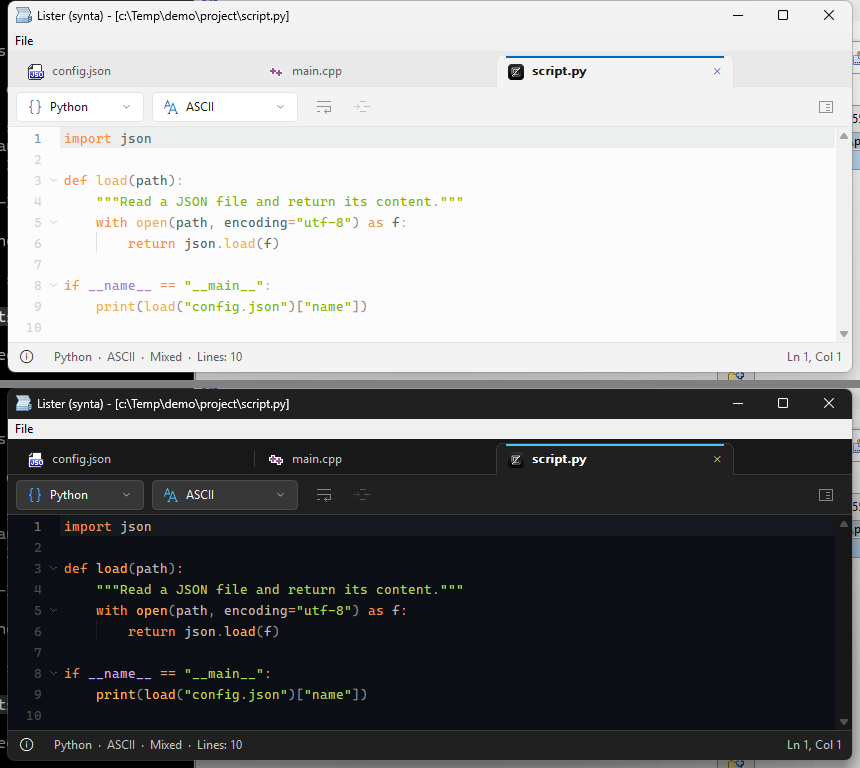

# Tabster

[English](README.md) | **Deutsch**

Tabs für den Lister des [Total Commander](https://www.ghisler.com), 32 und 64 Bit (Lister-Plugin).
F3 auf einer zweiten Datei, während ein Lister offen ist, und beide landen als Tabs in einem Fenster statt in zwei. Ein einzelner Lister bleibt ein normales Fenster; die Tabbar erscheint mit dem zweiten Tab. Tabster arbeitet mit jedem Lister-Plugin zusammen: Es merkt sich nur das Fenster und lässt das nächste Plugin die Datei anzeigen.

## Funktionen

- Klick auf einen Tab wechselt, Mittelklick oder die ×-Schaltfläche schließt ihn, Tabs lassen sich per Ziehen umsortieren, ein Tab aus der Leiste gezogen öffnet sich in einem eigenen Fenster
- **Eine Datei wird nur einmal geöffnet**: F3 auf eine Datei, die schon in einem Tab offen ist, zeigt diesen Tab, statt sie noch einmal zu öffnen (umschaltbar, siehe `AllowDuplicates`)
- Esc (oder ein anderer Lister-Schließbefehl) schließt nur den aktuellen Tab; das Fenster schließt mit dem letzten Tab
- Tabbar oben, unten, links oder rechts; Höhe und Breite der Tabs einstellbar
- Helles und dunkles Design im Windows-11-Look (wie Windows, hell, dunkel oder wie Total Commander)
- Rechtsklick auf die Leiste: Andere Tabs / Tabs rechts / Alle Tabs schließen, In eigenem Fenster öffnen, Pfad kopieren, Im Explorer anzeigen, Einstellungen, Über Tabster
- Benutzeroberfläche auf Deutsch und Englisch (folgt der Windows-Sprache)

## Download und Installation

1. **`Tabster.zip`** vom [neuesten Release](https://github.com/naderi/tc-tabster/releases/latest) herunterladen.
2. Das ZIP im Total Commander öffnen (Enter auf der Datei) und die Frage nach der Installation des Plugins bestätigen.
3. *Konfigurieren → Optionen → Plugins → Lister (WLX)*: Tabster an die **erste** Stelle schieben. Tabster merkt sich nur das Lister-Fenster und lässt das nächste Plugin die Datei anzeigen, deshalb muss es als Erstes gefragt werden.

Voraussetzung: Windows 10 oder 11.

## Tastenkürzel

| Taste | Aktion |
|---|---|
| Strg+Tab, Strg+Bild↓ | Nächster Tab |
| Strg+Umschalt+Tab, Strg+Bild↑ | Vorheriger Tab |
| Alt+1 … Alt+9 | Zu Tab 1 … 9 springen |
| Strg+W | Tab schließen |
| Strg+Umschalt+W | Alle Tabs schließen |
| Umschalt+Esc | Tab in eigenem Fenster öffnen |
| F11 | Maximieren |
| Esc | Aktuellen Tab schließen (Verhalten des Listers) |

Die Tasten lassen sich in einem Abschnitt `[Keys]` der `Tabster.ini` ändern, eine Zeile pro Aktion: `CloseTab=Ctrl+W`. Mehrere Alternativen werden durch Kommas getrennt (`NextTab=Ctrl+Tab, Ctrl+PgDn`); `None` schaltet eine Aktion ab. Die Aktionen heißen `NextTab`, `PrevTab`, `CloseTab`, `CloseAll`, `DetachTab`, `Maximize` und `Tab1` … `Tab9`; die Tasten werden englisch geschrieben (`Ctrl`, `Shift`, `Alt`, `PgUp`, `PgDn`, …).

## Einstellungen

Die `Tabster.ini` (Abschnitt `[Tabster]`) wird beim ersten Start neben dem Plugin angelegt; ist dieser Ordner schreibgeschützt, neben der ini des Total Commander. Die meisten Werte lassen sich auch im Rechtsklick-Menü der Tabbar ändern (*Einstellungen*); sie werden in die Datei zurückgeschrieben.

| Schlüssel | Werte | Bedeutung |
|---|---|---|
| `Theme` | `0` wie Windows (Standard), `1` hell, `2` dunkel, `3` wie Total Commander | Farbdesign |
| `TabPosition` | `Top` (Standard), `Bottom`, `Left`, `Right` | Wo die Tabbar sitzt |
| `TabHeight` | `20`–`64` (Standard `32`) | Höhe eines Tabs in Pixeln bei 96 dpi |
| `MinTabWidth` / `MaxTabWidth` | `60`–`600` (Standard `110` / `240`) | Tab-Breite einer oberen oder unteren Leiste |
| `SideTabWidth` | `100`–`500` (Standard `200`) | Breite einer linken oder rechten Leiste |
| `AlwaysShowTabs` | `1` / `0` (Standard `0`) | Tabbar auch bei einem einzelnen Tab zeigen |
| `CloseButton` | `1` / `0` (Standard `1`) | ×-Schaltfläche auf den Tabs |
| `InfoButton` | `1` / `0` (Standard `1`) | Info-Schaltfläche in der Tabbar |
| `WarnOnClose` | `1` / `0` (Standard `0`) | Vor dem Schließen aller Tabs nachfragen |
| `OpenNextToCurrent` | `1` / `0` (Standard `0`) | Neuen Tab neben dem aktuellen statt am Ende öffnen |
| `EscAction` | `0` schließt den Tab (Standard), `1` ignoriert Esc, `2` schließt alle Tabs | Was Esc tut |
| `AllowDuplicates` | `0` (Standard) / `1` | `0`: eine bereits offene Datei wird nicht noch einmal geöffnet, ihr Tab wird gezeigt; `1`: sie wird erneut geöffnet |

## Lizenz

Freeware – frei nutzbar, aber **nicht zum Verkauf**. Siehe [LICENSE](LICENSE).

## Unterstützung

Wenn Tabster dir Zeit spart, kannst du die Entwicklung auf Ko‑fi unterstützen. ☕

---

© 2026 [Ali Naderi](https://github.com/naderi) · [digitalent.dev](https://digitalent.dev/de/)
