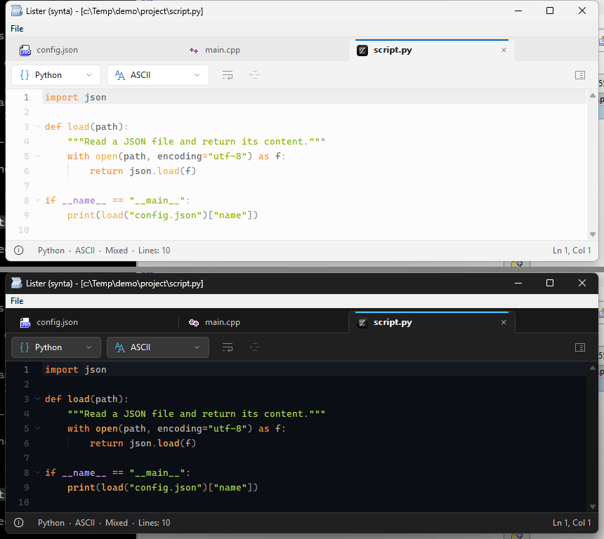

# Tabster

**English** | [Deutsch](README.de.md)

Tabs for the Lister of [Total Commander](https://www.ghisler.com), 32 and 64 bit (Lister plugin).
Press F3 on a second file while a Lister is open and both end up as tabs in one window instead of two. A single Lister stays an ordinary window; the tab bar appears with the second tab. Tabster works with any Lister plugin: it only notes the window and lets the next plugin show the file.

## Features

- Click a tab to switch, middle click or the × button closes it, drag tabs to reorder, drag a tab out of the bar to open it in its own window
- **A file is opened only once**: F3 on a file that is already open in a tab shows that tab instead of opening it again (switchable, see `AllowDuplicates`)
- Esc (or any Lister close command) closes only the current tab; the window closes with the last tab
- Tab bar at the top, bottom, left or right; tab height and width adjustable; color of the active tab selectable
- Light and dark design in the Windows 11 look (like Windows, light, dark or like Total Commander)
- Right click on the bar: close other tabs / tabs to the right / all tabs, open in own window, copy path, show in Explorer, settings (also *Edit ini file…*), About
- English and German user interface (follows the Windows language)

## Download and installation

1. Download **`Tabster.zip`** from the [latest release](https://github.com/naderi/tc-tabster/releases/latest).
2. Open the ZIP in Total Commander (Enter on the file) and confirm the question whether to install the plugin.
3. *Configuration → Options → Plugins → Lister (WLX)*: move Tabster to the **first** position. Tabster only notes the Lister window and lets the next plugin show the file, so it has to be asked first.

Requires Windows 10 or 11.

## Keys

| Key | Action |
|---|---|
| Ctrl+Tab, Ctrl+PgDn | Next tab |
| Ctrl+Shift+Tab, Ctrl+PgUp | Previous tab |
| Alt+1 … Alt+9 | Jump to tab 1 … 9 |
| Ctrl+W | Close tab |
| Ctrl+Shift+W | Close all tabs |
| Shift+Esc | Open the tab in its own window |
| F11 | Maximize |
| Esc | Close the current tab (Lister's own behaviour) |

The keys can be changed in a `[Keys]` section of `Tabster.ini`, one line per action: `CloseTab=Ctrl+W`. Several alternatives are separated by commas (`NextTab=Ctrl+Tab, Ctrl+PgDn`); `None` turns an action off. The actions are `NextTab`, `PrevTab`, `CloseTab`, `CloseAll`, `DetachTab`, `Maximize` and `Tab1` … `Tab9`.

## Settings

`Tabster.ini` (section `[Tabster]`) is created next to the plugin on first use; if that folder is read-only, next to Total Commander's ini. Most values can also be changed in the right-click menu of the tab bar (*Settings*); they are written back to the file.

| Key | Values | Meaning |
|---|---|---|
| `Theme` | `0` like Windows (default), `1` light, `2` dark, `3` like Total Commander | Color design |
| `TabPosition` | `Top` (default), `Bottom`, `Left`, `Right` | Where the tab bar sits |
| `TabHeight` | `20`–`64` (default `32`) | Height of a tab in pixels at 96 dpi |
| `MinTabWidth` / `MaxTabWidth` | `60`–`600` (default `110` / `240`) | Tab width of a top or bottom bar |
| `SideTabWidth` | `100`–`500` (default `200`) | Width of a left or right bar |
| `AlwaysShowTabs` | `1` / `0` (default `0`) | Show the tab bar also for a single tab |
| `CloseButton` | `1` / `0` (default `1`) | × button on the tabs |
| `InfoButton` | `1` / `0` (default `1`) | Info button in the tab bar |
| `WarnOnClose` | `1` / `0` (default `0`) | Ask before closing all tabs |
| `OpenNextToCurrent` | `1` / `0` (default `0`) | Open a new tab next to the current one instead of at the end |
| `EscAction` | `0` closes the tab (default), `1` ignores Esc, `2` closes all tabs | What Esc does |
| `ActiveTabColor` | `Accent` (default) or a color like `#0078D4` | Color of the bar on the active tab; `Accent` is the Windows accent color |
| `AllowDuplicates` | `0` (default) / `1` | `0`: a file that is already open is not opened again, its tab is shown instead; `1`: it is opened again |

## Languages

Tabster speaks English, German, Spanish, French, Russian, Ukrainian, Chinese (Simplified), Hindi, Portuguese and Persian. It follows the Windows display language; to pick another one, use the tab context menu (*Settings* → *Interface language*) or set `Language=<name or code>` in `Tabster.ini` (for example `Persian` or `fa`; `auto` follows Windows, `tc` follows Total Commander's own language – also the entry *Like Total Commander*).

The texts are plain `.lng` files in the `Languages` folder. To add a language, copy `Languages\Template.lng`, translate the right-hand sides and save it under a new name – it appears in the language list.

Corrections and new translations from native speakers are very welcome – please send them as an [issue](https://github.com/naderi/tc-tabster/issues) on this repository.

## License

Freeware – free to use, but **not for sale**. See [LICENSE](LICENSE).

## Support

If Tabster saves you time, you can support its development on Ko‑fi. ☕

---

© 2026 [Ali Naderi](https://github.com/naderi) · [digitalent.dev](https://digitalent.dev/en/)
